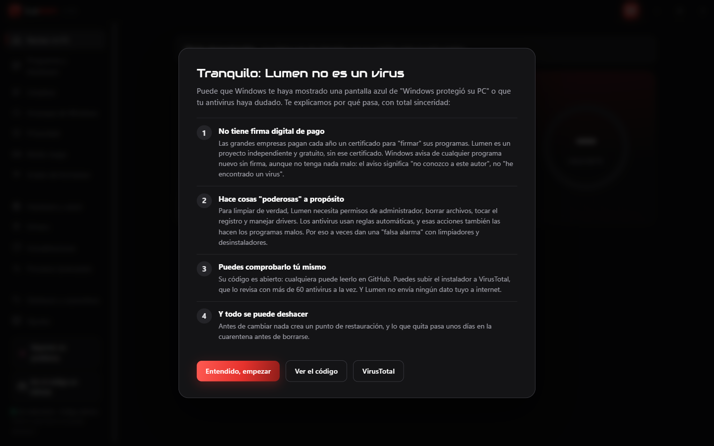
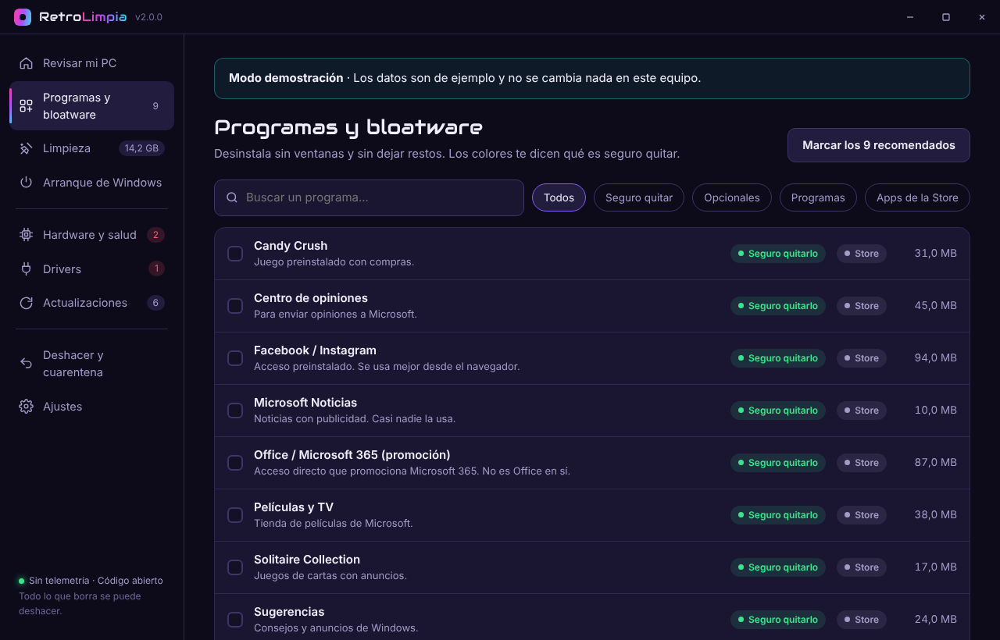
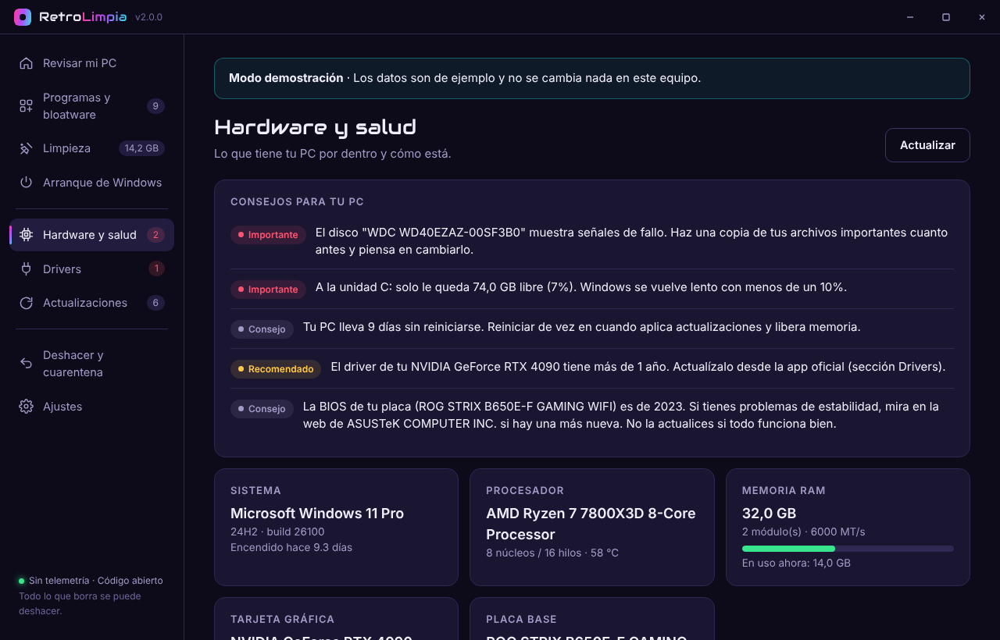

<p align="center"></p>

# Lumen

**Limpia tu PC, quita el bloatware sin dejar restos, revisa tu hardware y mantén tus drivers al día. Todo guiado paso a paso, pensado para quien no sabe nada de informática.**

Gratis · Código abierto (GPL-3.0) · Sin telemetría · Todo se puede deshacer

🌐 **Web oficial: [deancavero23-ops.github.io/Lumen](https://deancavero23-ops.github.io/Lumen/)**

**Idiomas: Español · Italiano · Inglés** (se detecta el idioma de Windows y se puede cambiar en Ajustes).

> **Proyecto derivado:** Lumen está basado en [RetroLimpia](https://github.com/retropunk94/RetroLimpia), de Retropunk94, publicado bajo GPL-3.0-or-later. Lumen es una versión modificada e independiente: no es la versión oficial. Mantiene la licencia GPL y los créditos originales.



## Descargar

Ve a **[Releases](../../releases/latest)** y descarga **`Lumen-Instalador-x.y.z.exe`**. Se instala como cualquier programa y, a partir de ahí, se actualiza solo.

> **¿Windows dice "Windows protegió su PC"?** Es normal y no significa que tenga un virus: el programa no tiene una firma digital de pago. Pulsa **Más información → Ejecutar de todas formas**. [Aquí te explicamos por qué pasa y cómo comprobarlo tú mismo](docs/POR-QUE-AVISA-WINDOWS.md).

## Qué hace

| | |
|---|---|
| **Revisar mi PC** | Un solo botón lo analiza todo y da una **nota de salud del 1 al 100**. Después, "Arreglar todo" aplica lo recomendado. |
| **Programas y bloatware** | Desinstala en silencio, sin el asistente de cada programa. Muestra cuánto pesa cada uno y su **impacto en el sistema** (si arranca con Windows, servicios y RAM). Marca cada programa en **verde** (seguro quitarlo), **amarillo** (opcional) o **rojo** (mejor no tocar). |
| **Restos** | Al desinstalar, una ventana te enseña en vivo qué hace y dónde (desinstalador, carpetas, registro) y al final te dice si **quedó algo en el registro**. Lo que seguro es del programa va a la cuarentena; lo dudoso te lo pregunta. |
| **Limpieza** | Temporales, caché de Windows Update, informes de error, miniaturas, caché de navegadores y **limpieza gamer** (shaders de NVIDIA/AMD/Intel/DirectX y caché de Steam, Battle.net y Discord). Nunca toca documentos, contraseñas ni historial. |
| **Restos de programas antiguos** | Carpetas vacías, accesos directos rotos y programas "fantasma" que dejaron cosas que ya desinstalaste (aunque no fuera con Lumen). Todo a la cuarentena. |
| **Privacidad** | Apaga anuncios del menú Inicio, apps que se instalan solas, publicidad personalizada, Bing en la búsqueda y el envío de datos opcional. Cada interruptor explicado y reversible. |
| **Modo Juego** | Cierra **solo lo que tú elijas** (OBS, Discord, Steam y periféricos protegidos), máxima potencia, notificaciones en silencio y Windows Update en pausa, con tres intensidades. Añade tus juegos o **emuladores** y se activa solo. Un botón lo deja todo como estaba. |
| **Acabo de formatear** | Pasos guiados tras instalar Windows: drivers, actualizaciones, programas imprescindibles instalados solos con winget (cada uno explicado), quitar bloatware, privacidad, ajustes cómodos y punto de restauración. |
| **¿Por qué se reinició?** | Traduce el registro de Windows: pantallazos azules (con su causa probable), apagados de golpe y reinicios de Windows Update. |
| **Lumi, la mascota** | Reacciona a lo que pasa. Se puede poner tranquila o apagar con un clic. |
| **Modo PC modesto** | En equipos con poca RAM o pocos núcleos se aligera solo: sin animaciones y con menos prioridad. 0 % de CPU en reposo siempre. |
| **Arranque** | Desactiva los programas que arrancan con Windows sin hacer falta. Usa el mismo interruptor que el Administrador de tareas. |
| **Hardware y salud** | CPU, gráfica, RAM, placa, BIOS, batería. **Salud y desgaste de los discos**, temperaturas y consejos fáciles de entender. |
| **Drivers** | Dispositivos con problemas, drivers antiguos y copia de seguridad de tus drivers. Solo fuentes oficiales: Windows Update y la app de NVIDIA, AMD o Intel. |
| **Actualizaciones** | Windows, drivers y programas (con winget): marca los que quieras o actualiza **todo de una vez**. |
| **Recordatorios** | Opcional: arranca en silencio con Windows y te avisa con una notificación cuando hay basura acumulada o actualizaciones pendientes. |
| **Procesos (avanzado)** | Qué consume más CPU y RAM ahora mismo, con opción de cerrarlo. Los procesos vitales de Windows están protegidos. |
| **Se actualiza solo** | Busca versión nueva en GitHub, descarga solo lo que cambió y se instala sola: con una cuenta atrás si lo estás usando (con botón "Más tarde") o en silencio si está en la bandeja. |
| **Deshacer** | Punto de restauración antes de cada cambio y **cuarentena de 7 días** con botón de restaurar. |

## Lumen vs Microsoft PC Manager

PC Manager es una buena herramienta básica. Lumen va más allá en lo que más se nota:

| | Lumen | PC Manager |
|---|:---:|:---:|
| Limpieza de temporales | ✅ | ✅ |
| Programas que arrancan con Windows | ✅ | ✅ |
| Desinstalar **en silencio y quitar los restos** (carpetas y registro) | ✅ | ❌ |
| Restos de programas desinstalados hace tiempo | ✅ | ❌ |
| Bloatware marcado por colores (seguro / opcional / no tocar) | ✅ | ❌ |
| Apagar anuncios y envío de datos de Windows | ✅ | ❌ |
| Drivers: problemas, copia de seguridad y fuentes oficiales | ✅ | ❌ |
| Actualizar todos tus programas de una vez (winget) | ✅ | ❌ |
| Salud y desgaste de los discos, temperaturas | ✅ | ❌ |
| ¿Por qué se reinició mi PC? (pantallazos azules explicados) | ✅ | ❌ |
| Modo Juego con emuladores y protección de OBS/Discord | ✅ | ❌ |
| Asistente tras formatear | ✅ | ❌ |
| Cuarentena de 7 días para deshacer | ✅ | ❌ |
| Código abierto y sin telemetría | ✅ | ❌ |

<sub>Comparado con PC Manager en noviembre de 2026. Si Microsoft añade algo, abre un issue y lo corregimos.</sub>




## Seguridad

- **Lista de protegidos:** los drivers, Visual C++, .NET, la Store y otras piezas del sistema no se pueden quitar, salvo en modo experto.
- **Rutas prohibidas:** Lumen nunca toca carpetas como `Windows`, `System32` o tu carpeta de usuario, aunque una búsqueda de restos las señale.
- **Sin webs de "drivers gratis":** los drivers vienen solo de Windows Update o del fabricante.
- **Sin telemetría ni servidor propio:** no envía datos de tu PC a ningún sitio por su cuenta. Si pulsas **Reportar un problema**, se abre un borrador de GitHub con el texto anonimizado; tú decides si lo publicas.
- **Registro de cambios:** cada cambio queda anotado en `C:\ProgramData\Lumen\logs`.

## Para desarrolladores

Está hecho con **Electron** (interfaz) y **PowerShell 5.1** (motor). El motor es el PowerShell que ya viene con Windows, así que no hay que instalar nada más. Tampoco depende de bases de datos externas que mantener: pregunta a Windows en el momento.

```
src/        proceso principal, puente seguro y motor que lanza los scripts (sin ventanas)
scripts/    un .ps1 por función; devuelven JSON (@@PROGRESS / @@RESULT)
data/       listas editables: bloatware.json, protegidos.json, inicio.json
renderer/   interfaz (HTML + CSS + JS, sin frameworks)
```

```bash
npm install
npm run demo     # interfaz con datos de ejemplo; no toca nada
npm start        # modo real (ábrelo como administrador)
npm run dist     # genera el instalador en dist/
```

**Añadir bloatware o reglas** es tan fácil como editar los archivos de `data/`. Los patrones admiten `*`.

**Publicar una versión:** cambia `version` en `package.json`, haz commit y crea una etiqueta `vX.Y.Z`. GitHub Actions compila el .exe y publica la Release con sus huellas SHA-256.

## Idiomas

Los textos de la interfaz viven en el código con su versión en inglés (`L(es, en)`) y en `locales/it.json` para italiano. Los avisos de PowerShell se traducen con `scripts/it-mensajes.json`. Para añadir otro idioma:

1. Añade el valor en el selector de Ajustes (`renderer/js/05-procesos.js`) y en `src/main.js` (`defaultSettings.idioma`).
2. Crea `locales/<idioma>.json` con las traducciones de las claves en español.
3. Genera los mensajes de scripts con `tools/traducir-scripts.ps1` adaptando el idioma de destino.

Para regenerar el italiano tras cambiar textos:

```powershell
powershell -ExecutionPolicy Bypass -File tools/traducir-i18n.ps1
powershell -ExecutionPolicy Bypass -File tools/traducir-scripts.ps1
```

Los iconos se regeneran con `powershell -ExecutionPolicy Bypass -File tools/generar-iconos.ps1`.

## Reportes

No hay Discord, donaciones ni servicios externos. **🐞 Reportar problema** abre un issue de GitHub ya redactado (sin enviar nada automáticamente). Configura tu repositorio en `package.json` → `lumen.repo` antes de publicar.

## Licencia y créditos

**GPL-3.0 o posterior:** puedes usar, estudiar, modificar y compartir el código, siempre que tu versión también se publique bajo GPL y conserve el aviso de autoría.

Lumen es una versión modificada de [RetroLimpia](https://github.com/retropunk94/RetroLimpia), creada por Retropunk94 y publicada bajo GPL-3.0-or-later. Se conservan la licencia y los créditos originales. El nombre **Lumen**, la mascota **Lumi** y su logo son propios de esta versión derivada y no representan al proyecto original. Ver [CRÉDITOS.md](CRÉDITOS.md).

Si cambias de usuario de GitHub, ejecuta `powershell -ExecutionPolicy Bypass -File tools/preparar-publicacion.ps1 -Usuario TU_NUEVO_USUARIO` y vuelve a compilar. Ver [PUBLICAR.md](PUBLICAR.md).
