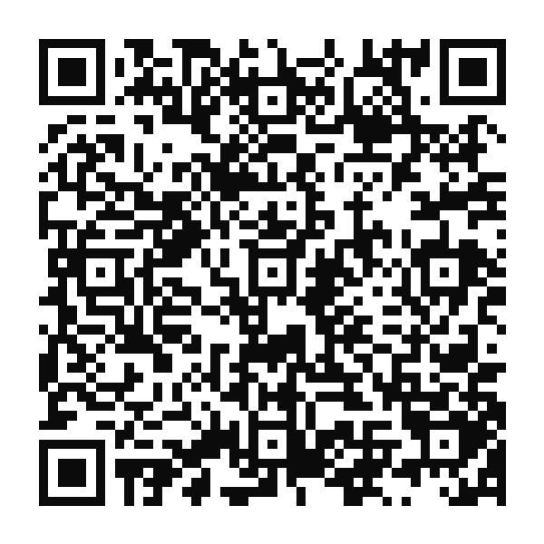

# Lumen para Android (APK + PWA, demo)

> **Aviso importante:** es una **demo**. Ni el APK ni la PWA limpian Android, borran archivos, desinstalan apps ni quitan anuncios de otras aplicaciones. Muestran la interfaz de Lumen, Lumi con voz femenina y simulaciones. Las funciones reales están en la versión de Windows.
>
> Si buscas una APK que **sí analice el móvil**, usa [Lumen Seguridad](SEGURIDAD-ANDROID.md): app nativa Kotlin, escrita desde cero, con análisis de apps, cuarentena restaurable y batería real. Es otra APK distinta y se instala junto a esta.

Lumen tiene un **APK instalable**: es un envoltorio propio (Trusted Web Activity) de la misma PWA. No copia código de CCleaner: usa la identidad, Lumi, los tres idiomas y el bloqueo de anuncios dentro de la app.

## Descargar el APK

**[Descargar Lumen-1.0.0.apk](https://github.com/deancavero23-ops/Lumen/releases/download/v1.0.0/Lumen-1.0.0.apk)** · [Verificar SHA-256](https://github.com/deancavero23-ops/Lumen/releases/download/v1.0.0/SHA256-APK.txt)

Escanea este QR con el móvil para abrir la descarga del APK. Huella del archivo: `8ea511db1fb5e3fe1e79f5dfa16e37779b8f41b92dc80d559d9208ffa56cb5b7`.

- Necesita **Android 7.0 o superior** con **Chrome** instalado.
- Al abrir el APK fuera de Google Play, Android pedirá permitir **fuentes desconocidas**: acepta solo si confías en este repositorio.
- El APK se actualizará con el contenido publicado en la web; la primera vez descarga los audios de Lumi.

**URL de la PWA:** https://deancavero23-ops.github.io/Lumen/app/

## QR de la PWA (sin APK)

Este otro QR abre la versión web. Se abrirá directamente la app; luego usa el menú de Chrome → **Añadir a pantalla de inicio**. El mismo QR está publicado en la web principal.

## Instalarla en el móvil

1. Abre Chrome en el móvil y entra en la URL de arriba.
2. Pulsa el menú de Chrome (⋮) → **Añadir a pantalla de inicio** / **Instalar app**.
3. Aparece el icono rojo de Lumen en la pantalla de inicio. Ábrelo: funciona a pantalla completa y sin conexión.

Dentro de la app, en **Ajustes → Instalar en el móvil**, también se ofrece el diálogo de instalación cuando Chrome lo permite.

## Si el QR no te instala nada

El **QR de la PWA** no descarga un APK: abre la página web. Para que aparezca la opción de instalar:

1. Si la abrió la cámara, WhatsApp, Instagram u otra app, pulsa el menú **⋮ → Abrir en Chrome**.
2. Espera un segundo y pulsa de nuevo **⋮ → Instalar app** o **Añadir a pantalla de inicio**.
3. Confirma **Instalar / Añadir**. Aparecerá el icono rojo de Lumen en la pantalla de inicio.

Si sigue sin aparecer, actualiza Chrome, sal del modo incógnito y comprueba que la dirección termina exactamente en `/app/`. El QR verificado apunta a `https://deancavero23-ops.github.io/Lumen/app/`.

## Qué hace

- Misma identidad: logo rojo con “L” negra y chispa blanca, colores negro/rojo/gris/blanco.
- **Lumi interactúa**: toca la mascota y aparece un globo con mensajes; cambia de expresión mientras revisa y al terminar.
- El botón **“Hablar con Lumi”** (y tocar la mascota) reproduce **audios femeninos grabados** en español, italiano e inglés. Si falta el audio, usa la voz del móvil prefiriendo una femenina y con tono más agudo. Si activas **“Que Lumi hable en voz alta”** en Ajustes, también hablan los mensajes automáticos.
- Idiomas **español, italiano e inglés**, detectados desde el móvil y cambiables en Ajustes.
- Pantallas de Inicio, Limpieza, Arranque, Privacidad, Batería y Ajustes con datos de ejemplo.
- **Cuidado de batería:** lee el estado real del móvil cuando el navegador lo permite y activa un modo ahorro que reduce animaciones, parpadeos y trabajo en segundo plano.
- **Bloqueo de anuncios real dentro de Lumen:** una política de contenido impide scripts y conexiones de terceros, y el service worker descarta dominios publicitarios conocidos. Se puede activar o desactivar en **Privacidad**.
- Funciona **sin conexión** gracias al service worker (`docs/sw.js`).

## Límite importante

Es una **demo**: no limpia el móvil, no desinstala apps, no toca permisos ni actualiza nada. Tampoco puede quitar los anuncios del navegador ni de otras aplicaciones: el bloqueo actúa **solo dentro de Lumen**. Android no permite ese tipo de acciones desde una PWA (y Google Play las prohíbe salvo casos muy concretos). Las funciones reales de Lumen siguen siendo exclusivas de la versión de Windows.

## Archivos

- `docs/app/index.html` — interfaz y política de contenido (bloqueo de scripts y conexiones externas)
- `docs/app/styles.css` — estilos y modo ahorro
- `docs/app/app.js` — idiomas, Lumi, voz, batería, bloqueo de anuncios y demo
- `docs/manifest.webmanifest` — definición de la PWA
- `docs/sw.js` — caché offline y filtro de dominios publicitarios
- `docs/img/pwa-*.png` — iconos 192, 512 y maskable
- `docs/img/qr-android-apk.png` — QR verificado de descarga del APK
- `docs/app/audio/*.wav` — voces femeninas grabadas para Lumi
- `android/` — proyecto del APK (Bubblewrap/TWA) y certificado de firma

Créditos: Lumen se basa en RetroLimpia, de Retropunk94 (GPL-3.0-or-later). No es la versión oficial.
