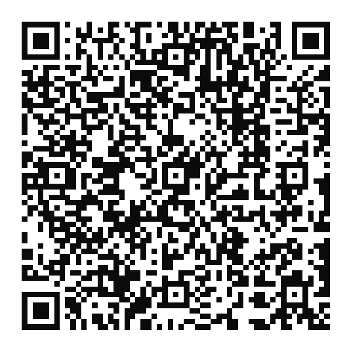

# Lumen Seguridad (Android nativo)

> **Aplicación nueva, escrita desde cero en Kotlin.** No contiene código de CCleaner ni de RetroLimpia, no es la versión oficial de CCleaner y **no reemplaza a Play Protect**. Es un proyecto *clean-room* publicado bajo GPL-3.0-or-later, con los créditos de RetroLimpia en `CRÉDITOS.md`.

Esta APK **sí hace cosas reales**, a diferencia de la demo TWA descrita en [ANDROID.md](ANDROID.md). Las dos conviven: la demo sirve para probar la interfaz y esta para analizar el móvil dentro de los límites que Android permite a una app sin root.

## Descargar

**[Descargar Lumen-Seguridad-1.0.0.apk](https://github.com/deancavero23-ops/Lumen/releases/download/seguridad-v1.0.0/Lumen-Seguridad-1.0.0.apk)** · [SHA-256 publicado](https://github.com/deancavero23-ops/Lumen/releases/download/seguridad-v1.0.0/SHA256-SEGURIDAD.txt)



- Requiere **Android 7.0 (API 24) o superior**.
- Se instala por **sideload**: al abrir la APK, Android pedirá permitir **fuentes desconocidas**. Acepta solo si confías en este repositorio.
- La firma es propia (`android-native/lumen-seguridad.keystore`, alias `lumen`). **No es la misma firma** que la APK demo, por lo que Android las tratará como apps distintas y podrás tener las dos instaladas.
- Para verificar la descarga: `certutil -hashfile Lumen-Seguridad-1.0.0.apk SHA256` en Windows o `sha256sum Lumen-Seguridad-1.0.0.apk` en Linux.

## Lo que sí hace

| Función | Cómo funciona | Límite real |
|---|---|---|
| **Análisis de apps instaladas** | Lee el APK de cada app, calcula su SHA-256, obtiene el certificado firmante, el instalador y sus permisos sensibles. Ordena por riesgo (mayor puntuación primero). | No tiene una base de virus: `assets/reglas.json` es una lista local editable de hashes y firmantes. Un hash desconocido **no significa** que sea malware. |
| **Señales de riesgo** | Cuenta permisos como SMS, contactos, ubicación, cámara, micrófono, `SYSTEM_ALERT_WINDOW`, `REQUEST_INSTALL_PACKAGES`; detecta servicios de accesibilidad e instalación fuera de tienda. | Es una orientación, no un veredicto. Muchas apps legítimas piden esos permisos. |
| **Aviso de nuevas apps** | Mientras Lumen está abierto, avisa cuando se instala un paquete y lo analiza. | Android 8+ no permite escuchar ese evento en segundo plano desde el manifiesto; el aviso solo está activo con la app abierta. |
| **Escaneo de archivos** | Con el selector de carpetas del sistema (SAF), recorre hasta 5.000 archivos y marca temporales, `.log`, vacíos, APK con más de 30 días y duplicados por nombre y tamaño. | Lee **solo la carpeta que eliges**. No toca los datos privados de otras apps. |
| **Cuarentena restaurable** | Mueve los archivos marcados a `LumenCuarentena` dentro de esa misma carpeta y guarda su ruta original en `cuarentena.json`. Cada elemento se puede restaurar con un toque. | Si el proveedor de archivos no permite mover, intenta copiar y borrar. Nada se elimina de forma definitiva. |
| **Batería real** | Lee nivel y estado de carga con `BatteryManager`. El "modo ahorro de Lumi" es una preferencia de la app. | No cambia ajustes del sistema ni limita procesos de otras apps. |
| **Desinstalar con confirmación** | Abre el diálogo del sistema con `ACTION_UNINSTALL_PACKAGE`. | La app nunca desinstala por sí sola; el usuario confirma siempre. |
| **Lumi y voces** | Mascota dibujada en código y 15 audios femeninos incluidos (`es`, `it`, `en`). Si falla el audio, usa TTS prefiriendo voces femeninas. | Se puede silenciar en Ajustes. |
| **Idiomas** | Español, italiano e inglés, detectados del sistema y cambiables en Ajustes. | — |
| **Privacidad** | Sin telemetría, sin servidor propio, sin accesibilidad y sin permisos de almacenamiento amplio. | Las reglas viven en el APK; para actualizarlas hay que publicar una versión nueva (o editar el archivo en una compilación propia). |

## Lo que NO hace (y no puede hacer sin root)

- **No reemplaza a Play Protect.** Google ya analiza apps en la nube y en el dispositivo; esta app es una segunda opinión local.
- No limpia la caché de otras apps: Android aísla los datos de cada aplicación.
- No borra archivos directamente con `MANAGE_EXTERNAL_STORAGE`: usa el selector del sistema.
- No desinstala apps del sistema ni las de otros usuarios.
- No bloquea anuncios dentro de otras apps ni a nivel global (no hay `VpnService` en esta versión). El bloqueo de la PWA actúa solo dentro de Lumen.
- No escanea en segundo plano ni envía resultados a ningún servidor.
- No garantiza la ausencia de malware: solo compara contra reglas locales y muestra señales de riesgo.

## Permisos

- `QUERY_ALL_PACKAGES`: imprescindible para listar y analizar las apps instaladas, que es la función central de un analizador de seguridad. Al distribuirse por sideload no necesita el formulario de permisos sensibles de Google Play. Si algún día se publica en Play, habrá que justificarlo ante Google.
- No pide `INTERNET`, `READ/WRITE_EXTERNAL_STORAGE`, `MANAGE_EXTERNAL_STORAGE`, accesibilidad ni permisos de SMS/contactos. El acceso a archivos se concede carpeta por carpeta desde el selector del sistema.

## Compilar

```bash
cd android-native
./gradlew assembleRelease
```

El workflow [`.github/workflows/apk-seguridad.yml`](../.github/workflows/apk-seguridad.yml) compila y firma la APK con el certificado del repositorio al publicar una etiqueta `seguridad-v*`, y sube el APK junto con `SHA256-SEGURIDAD.txt` a la Release. Para probar sin publicar: `workflow_dispatch` en Actions.

Estructura:

```
android-native/app/src/main/java/com/lumen/seguridad/
  Analizador.kt   paquetes, hashes, certificados y puntuación de riesgo
  Limpieza.kt     escaneo SAF, cuarentena y restauración
  Voz.kt          audios femeninos + TTS de respaldo
  Textos.kt       es / it / en
  LumiView.kt     mascota dibujada
  MainActivity.kt interfaz y flujos
android-native/app/src/main/assets/
  reglas.json     base local de hashes, firmantes y permisos
  audio/          15 WAV femeninos
```

## Créditos

Lumen se basa en [RetroLimpia](https://github.com/retropunk94/RetroLimpia), de Retropunk94 (GPL-3.0-or-later). No es la versión oficial. Lumen Seguridad es una implementación independiente inspirada en las *funciones* de los limpiadores de Android, sin copiar código de CCleaner ni de ningún producto propietario. Enlaces: [web](https://deancavero23-ops.github.io/Lumen/) · [repositorio](https://github.com/deancavero23-ops/Lumen) · [releases](https://github.com/deancavero23-ops/Lumen/releases).
